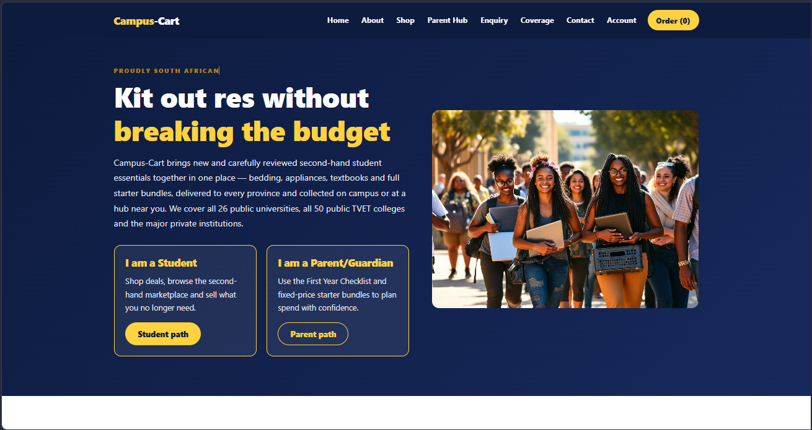
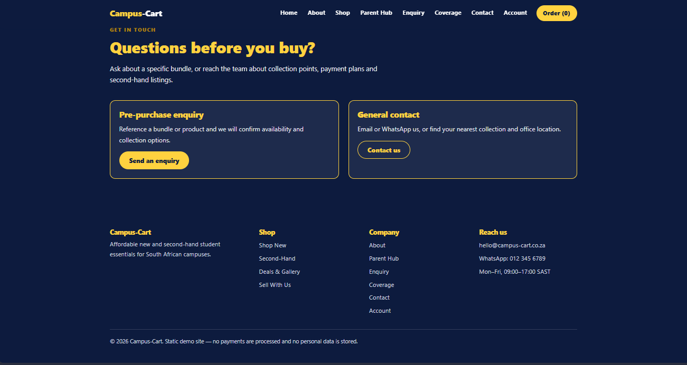
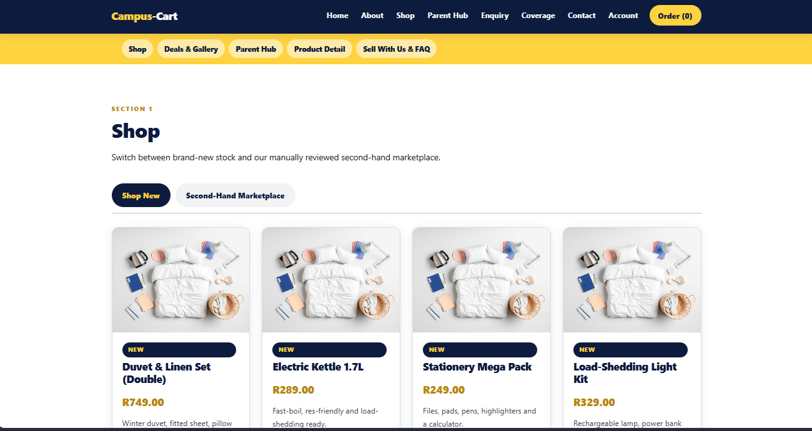
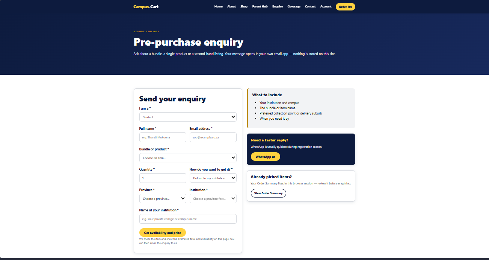
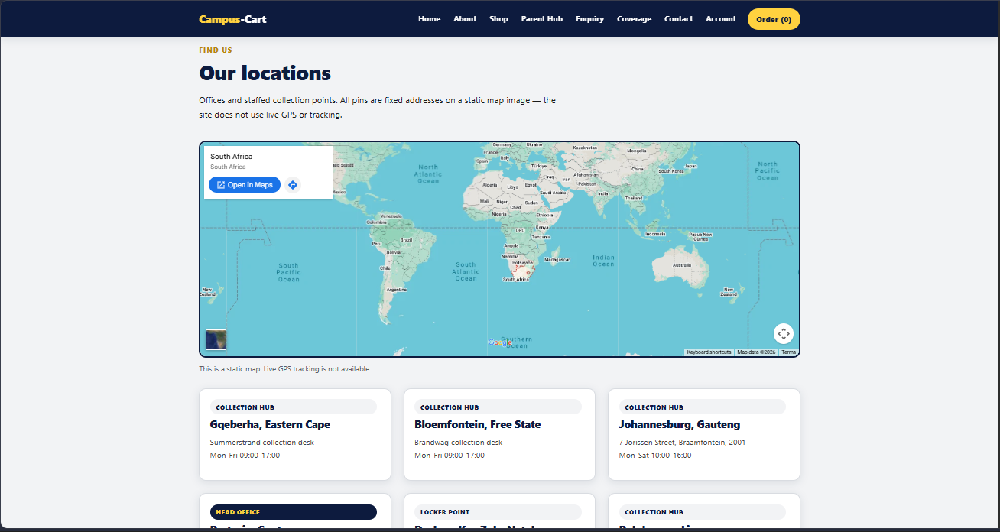
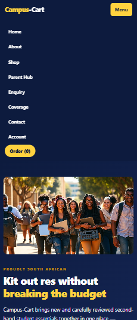
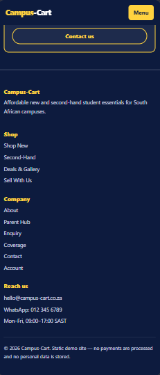
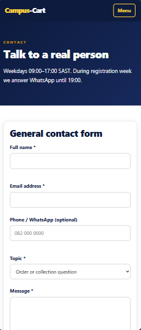
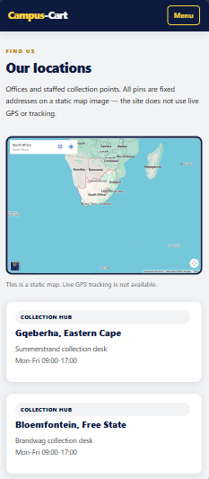

# Campus-Cart

## Project Title
**Campus-Cart** — a static, front-end e-commerce website designed to connect South African tertiary students and their parents/guardians with affordable new and second-hand student essentials.

## Student Information
- **Name:** Leletu Kamana
- **Institution:** The IIE Rosebank International, Port Elizabeth Campus
- **Programme:** Diploma in Information Technology (Software Development), First Year
- **Student Email:** st10514888@rcconnect.edu.za
- **GitHub:** [leletu-kamana](https://github.com/leletu-kamana)

## Live Website

**View Campus-Cart:** [https://campus-cart-olive.vercel.app/](https://campus-cart-olive.vercel.app/)/ [https://leletu-kamana.github.io/campus-cart/](https://leletu-kamana.github.io/campus-cart/)

The website is published using GitHub Pages and Vercel Pages. It is a front-end demonstration and does not process real payments or use real user accounts.

## Project Overview
Campus-Cart is a fictional South African organisation created as a website project. The idea is to make it easier for students and families to find common tertiary-study essentials such as bedding, appliances, stationery, furniture, textbooks and starter bundles.

The website has two main audiences:
1. **Students** who need affordable essentials or want to sell items they no longer need.
2. **Parents/guardians** who want to plan and budget for a student's first-year essentials.

The project uses **HTML5, CSS3 and vanilla JavaScript**. It is a front-end demonstration and does not use a backend database, real user authentication or an online payment gateway. This keeps the project focused on website structure, content, navigation, responsive design and client-side interaction.


## Project Goals and Objectives

### Goals
- Provide an easy-to-use online catalogue for student essentials.
- Offer both new and second-hand product options.
- Give parents/guardians a Parent Hub with a checklist and starter bundles.
- Provide students with a basic way to prepare an order summary before contacting the business.
- Provide a Sell With Us section for second-hand listings.
- Present the website in a responsive layout for desktop and mobile screens.

### Objectives
- Create a clear navigation structure between the main website pages.
- Use semantic HTML5 elements to organise the content.
- Use external CSS for consistent styling across the website.
- Use JavaScript for client-side features such as tabs, filtering and the order summary.
- Include accessible text alternatives for images through `alt` attributes.
- Keep the interface simple for students and parents/guardians.

## Target Audience

### Primary Audience: Students
Students aged approximately 19–30 who may live in residence, digs or at home and need affordable study and living essentials.

### Secondary Audience: Parents and Guardians
Parents and guardians who help students prepare for registration and the start of the academic year and want clearer information about products, prices and collection options.

## Technologies Used

| Technology | Use in the Project |
|---|---|
| HTML5 | Page structure, semantic elements, forms, navigation, tables and content. |
| CSS3 | Layout, colours, typography, cards, buttons and responsive design. |
| JavaScript | Client-side interaction: tabs, search, filtering and sorting, order summary, form validation, lightbox, quick-view modal, accordion, hub map and scroll animation. |
| Leaflet 1.9.4 | Open-source JavaScript map library (BSD-2-Clause licence). Stored locally in `assets/vendor/leaflet/` so no third-party script is loaded from another site. |
| OpenStreetMap | Map tiles and data for the collection-hub map, credited on the map. |
| Fetch API (AJAX) | The enquiry form loads stock levels from `assets/data/stock.json` without reloading the page. |
| Git | Version control. |
| GitHub | Repository and version management. |

No frontend framework is used. The project is built with standard HTML, CSS and JavaScript so the underlying web-development concepts remain clear.

## Website Screenshots

This section is for **genuine screenshots of the rendered Campus-Cart website**. It supports visual evidence of the completed website across both desktop and mobile screen sizes.

The repository reserves the following folder for the screenshots:

`assets/images/screenshots/`

A minimum of **5 desktop screenshots and 5 mobile screenshots** can be added. Additional screenshots may also be included if they provide useful evidence of different pages, sections or responsive states.

### Desktop Website Screenshots

Add the genuine desktop browser screenshots to `assets/images/screenshots/` using these filenames:











### Mobile Website Screenshots

Add the genuine mobile browser screenshots to `assets/images/screenshots/` using these filenames. The screenshots are displayed **side by side in a horizontal gallery** so the mobile evidence is aligned consistently in the README.

<table>
  <tr>
    <td align="center">
      
    </td>
    <td align="center">
      
    </td>
    <td align="center">
      
    </td>
    <td align="center">
      
    </td>
    <td align="center">
      
    </td>
  </tr>
  <tr>
    <td align="center"><strong>Mobile 1</strong></td>
    <td align="center"><strong>Mobile 2</strong></td>
    <td align="center"><strong>Mobile 3</strong></td>
    <td align="center"><strong>Mobile 4</strong></td>
    <td align="center"><strong>Mobile 5</strong></td>
  </tr>
</table>

> **Screenshot requirement:** Screenshot files must be captured from the actual rendered Campus-Cart website in a browser. Do not use planning wireframes, generated mock-ups or individual project images as substitutes for website screenshots. Upload the screenshot files to `assets/images/screenshots/` with the matching filenames so the README images display correctly.

> **Additional screenshots:** If more than five desktop or mobile screenshots are added, continue the same naming pattern (for example, `desktop-06.png`, `desktop-07.png`, `mobile-06.png`, `mobile-07.png`).

## Part 1 – Planning and Initial Development
Part 1 covers the planning and initial development of Campus-Cart, with the initial website structure developed using **HTML5**. The planning identifies the organisation idea, target audience, page content, site structure and navigation before visual styling and interactive features are added. Semantic elements such as headings, navigation, sections, lists, images, links and forms help organise the information into a clear document structure (Duckett, 2011).

Campus-Cart is a fictional South African student-essentials store. The website is planned around two main user groups: students who need affordable study and living essentials, and parents/guardians who help plan and budget for those items. The focus on access to affordable learning materials is also relevant to discussions of educational inequality and open educational practices (Cox, Masuku and Willmers, 2020).

### Website Pages and Features

| Page | File | Main Purpose |
|---|---|---|
| Home | `index.html` | Introduces Campus-Cart, its mission, featured products and the two main user paths. |
| About | `pages/about.html` | Explains the organisation, mission, vision and target audience. |
| Products | `pages/products.html` | Contains Shop, Deals & Gallery, Parent Hub, Product Detail and Sell With Us sections. |
| Enquiry | `pages/enquiry.html` | Provides a pre-purchase enquiry form. |
| Contact | `pages/contact.html` | Provides general contact and collection/office information. |
| Account | `pages/account.html` | Provides Student/Parent paths and the HTML structure for an Order Summary. |

### Page Content, Purpose and Target Users

| Page | Main Content | Purpose | Target User |
|---|---|---|---|
| Home (`index.html`) | Introduction, featured essentials, main navigation and links to shopping, Parent Hub and account information | Introduce Campus-Cart and help visitors choose where to go next | Students and parents/guardians |
| About (`pages/about.html`) | Organisation background, mission, vision and intended audience | Explain what Campus-Cart is and who it serves | New visitors, students and parents/guardians |
| Products (`pages/products.html`) | Shop New, second-hand marketplace, deals/gallery, Parent Hub, product detail and Sell With Us | Help visitors review products, prices, bundles and selling information | Students and parents/guardians |
| Enquiry (`pages/enquiry.html`) | Pre-purchase enquiry form and enquiry details | Give visitors a way to ask about stock, products and arrangements | Prospective buyers |
| Contact (`pages/contact.html`) | Contact methods, business information and collection information | Make it clear how visitors can contact the fictional business | All visitors |
| Account (`pages/account.html`) | Student and parent/guardian paths, order-summary layout and hand-off information | Provide a place to review the planned order process; it is not real account authentication | Students and parents/guardians |

### Low-Fidelity Wireframes

These simple planning wireframes show the intended content order and page layout. They are structural guides rather than screenshots of the finished styled website.

**Home page wireframe**

```text
+--------------------------------------------------------------+
| LOGO                 MAIN NAVIGATION                 ACCOUNT |
+--------------------------------------------------------------+
| HERO: Campus-Cart introduction       | HERO IMAGE            |
| Short description + Shop / Parent Hub buttons                 |
+--------------------------------------------------------------+
| BUY / SELL HIGHLIGHT CARDS                                   |
+--------------------------------------------------------------+
| FEATURED PRODUCTS / STARTER BUNDLE CARDS                      |
+--------------------------------------------------------------+
| ABOUT / CONTACT LINKS                                        |
+--------------------------------------------------------------+
| FOOTER: Shop links | Company links | Contact details         |
+--------------------------------------------------------------+
```

**Products page wireframe**

```text
+--------------------------------------------------------------+
| LOGO                 MAIN NAVIGATION                 ACCOUNT |
+--------------------------------------------------------------+
| PAGE TITLE + INTRODUCTION                                    |
+--------------------------------------------------------------+
| SHOP TABS: NEW / SECOND-HAND                                 |
| FILTERS / SORTING CONTROLS                                   |
| PRODUCT CARD GRID: IMAGE / NAME / PRICE / DETAILS            |
+--------------------------------------------------------------+
| DEALS & GALLERY                                              |
+--------------------------------------------------------------+
| PARENT HUB: CHECKLIST + STARTER BUNDLES                      |
+--------------------------------------------------------------+
| PRODUCT DETAIL                                               |
+--------------------------------------------------------------+
| SELL WITH US / FAQ                                           |
+--------------------------------------------------------------+
| FOOTER                                                       |
+--------------------------------------------------------------+
```

### Products Page Sections
- `#shop` — Shop New and Second-Hand Marketplace tabs/sections.
- `#deals-gallery` — Deals and Gallery with product information.
- `#parent-hub` — First Year Checklist and starter bundles.
- `#product-detail` — Product detail information/template.
- `#sell-with-us` — Sell With Us information and FAQ.

### Account Page
The Account page is part of the **HTML-only development in Part 1**. It provides the HTML structure for Student and Parent/Guardian paths and an Order Summary section. The page does not provide real user accounts, passwords, payment processing or completed JavaScript functionality at this stage.

The HTML structure was created first so that the content, navigation and page sections were in place before the styling and interactive functionality were developed.

## Part 2 – CSS Development
Part 2 focuses on the **CSS development and visual design** of Campus-Cart. The website uses an external CSS stylesheet so the same styling can be applied across the different HTML pages. The CSS is used to control the appearance, layout, spacing, typography and responsive behaviour of the website.

### CSS Features
The main CSS features used in Campus-Cart include:
- **CSS variables** for the main colours, making the design easier to keep consistent and update.
- **CSS reset** rules to provide a consistent starting point across different browsers.
- **Typography styling** for headings, paragraphs, labels and important text.
- **Responsive layouts** using flexible widths, CSS Grid, Flexbox and media queries for desktop, tablet and mobile screens.
- **Navigation styling** for the main navigation, links, buttons and mobile navigation controls.
- **Hero and section layouts** for organising the main content areas of the pages.
- **Cards and grids** for displaying products, information and other content in a structured way.
- **Buttons, badges and form controls** with consistent spacing, borders, colours and states.
- **Product and gallery layouts** for presenting product images, details and prices.
- **Form styling** for enquiry, contact and other input areas.
- **Responsive and accessibility-related styling**, including keyboard focus states and reduced-motion support.
- **Print styling** for content that may need to be printed, such as checklist information.

The main aim of Part 2 is to turn the HTML structure from Part 1 into a consistent and responsive website design while keeping the CSS organised and reusable. The stylesheet uses reusable variables and responsive layout rules to keep the design consistent across different screen sizes. Responsive web design principles are relevant because the layout must adapt to different devices and viewport sizes (Marcotte, 2011).

## Part 3 – Interactive Functionality, SEO, Forms and Publishing
Part 3 turns Campus-Cart from a styled set of pages into a working, searchable and published website. Every feature below supports the storyline of the site: a student or parent finds essentials, checks price and delivery for their institution, and collects the order from a hub.

### JavaScript Features
| Feature | Where | What it does for the visitor | Files |
|---|---|---|---|
| Interactive map | `contact.html` | Shows every collection hub as a pin on a Leaflet map. Clicking a pin shows the address and opening hours. A dropdown jumps to a hub for keyboard users. The map resizes for phones and the scroll wheel only zooms after the map is clicked. | `features.js`, `data.js`, `vendor/leaflet/` |
| Image lightbox | Every page with photos (`index.html`, `about.html`, `products.html`) | Clicking or pressing Enter on any content photo opens a larger image with caption, previous, next and close controls. Arrow keys, Esc, the dark background and swipe gestures also work. Product cards that JavaScript adds later are included. Logos, icons, linked images and map tiles are left out. | `features.js` |
| Quick-view modal | `products.html` | Opens a deal in a dialog with a larger photo, description and an Add to Order Summary button. Focus stays inside the dialog and returns to the button when it closes. | `features.js`, `script.js` |
| Accordion | `products.html` (Student and Parent FAQ) | Questions open and close with a click. Only one answer in a group stays open. Built on the native `<details>` element so it still works without JavaScript. | `features.js` |
| Dynamic content | `products.html` | The deal cards are generated from a JavaScript array rather than typed into the HTML. | `script.js` |
| Search, filter and sort | `products.html` | Keyword search across name, category and description, plus category and condition filters and sorting by price or name. A counter shows how many deals match. | `script.js` |
| Tabs | `products.html` | Shop New and Second-Hand tabs, Student and Parent FAQ tabs and gallery category buttons. | `script.js` |
| DOM manipulation | All pages | Cards, the Order Summary table, toast messages, the map pins and the lightbox are created, shown, hidden and updated by JavaScript. | `script.js`, `features.js` |
| Animation | All pages | Cards fade in as they scroll into view, the lightbox and modal fade in, accordion answers slide open and the page loader plays between pages. Animations are shortened or removed for visitors who ask their device to reduce motion. | `styles.css`, `features.js` |
| Printable checklist | `products.html` (Parent Hub) | The Print this checklist button prints only the First Year Checklist, as a clean one-page sheet with an empty box beside each item. The rest of the page is hidden while printing. | `script.js`, `styles.css` |
| Coverage search | `coverage.html` | Filters the list of institutions as the visitor types. | `forms.js` |

### Forms
| Form | Purpose | Behaviour |
|---|---|---|
| `enquiry.html` | A pre-purchase question about one product or bundle for one institution. | Fields use HTML5 attributes (`required`, `type`, `minlength`, `maxlength`, `min` and `max`). JavaScript then checks the rules specific to Campus-Cart and shows an error beside each wrong field. A valid enquiry shows a response with price, stock status and an estimated delivery date, and offers a professionally worded email the visitor can send. Stock levels are loaded with `fetch()` from `assets/data/stock.json`. If that file cannot be loaded, for example when the page is opened directly from a folder, a built-in copy of the same table is used. |
| `contact.html` | A general message or complaint to Campus-Cart. | Collects contact details, a topic (including complaints about an order), an optional order reference, the outcome the visitor wants and the message, using HTML5 attributes (`required`, `type`, `pattern`, `minlength` and `maxlength`). After validation the details are compiled into a professional email addressed to the recipient written in the form's `data-mailto` attribute, ready for the visitor to send. |

**Step-by-step form gate.** On both forms the visitor cannot continue until the current field is correct. Each field stays locked until the one before it passes validation, the error message appears when the visitor leaves a wrong field, and the submit button stays disabled until every field is valid. A message above the button names the field to complete next. If an earlier field is changed to something invalid, the later fields lock again. The logic is in `setupFormGate()` in `forms.js`, and the same checks are used again when the form is submitted.

**Professional email layout.** Both compiled emails follow the same four characteristics of a professional message: a clear subject line that names the request or problem, a polite and formal tone, the relevant details (order reference, item, quantity, institution), and a clear request. For example, a complaint with an order reference produces the subject "Complaint Regarding Order CC-1025", and the body has a greeting, the details, a "Requested outcome" sentence, a closing line and the sender's contact details.

Both `<form>` elements have an `action` attribute (a `mailto:` address) and `method="post"`. JavaScript normally stops the default submission and shows the response on the same page. The `action` is the fallback if JavaScript is unavailable. Both forms were designed around their own purpose and do not share the same fields.

### Search Engine Optimisation
- **Titles and descriptions:** every page has its own title and meta description that describe that page.
- **Headings:** every page has exactly one `<h1>` followed by `<h2>` and `<h3>` headings in order. The Products page had no `<h1>` and now has one.
- **Keywords:** the pages target words a student or parent would realistically search for. The keywords meta tag lists student essentials, South Africa, university, TVET college, second-hand, starter bundle and delivery, and the same words appear in the page titles, descriptions and headings.
- **Sharing and indexing:** each page has a canonical address, Open Graph and Twitter card tags for link previews, a theme colour and a favicon. The home page includes `Organization` structured data.
- **Images:** descriptive file names, meaningful `alt` text, and width and height attributes. The largest photographs were compressed without changing their names or dimensions (see the changelog).
- **URLs and links:** short readable page names such as `pages/coverage.html`, and internal links with descriptive anchor text.
- **Crawling:** `sitemap.xml` lists the seven public pages and `robots.txt` points to it. A custom `404.html` helps visitors who follow an old link.
- **Off-page and local SEO:** the Google Search Console ownership tag is on every page. Collection hub addresses are written the same way on the Contact page and on the map. No backlinks have been created, so none are claimed here.
- **Mobile and speed:** the layout is responsive, the map and lightbox are sized for phones, and the page-transition delay was shortened.

### Security
- Form input is validated for format and length, and text is escaped before it is placed in the page.
- Map popups, the lightbox and the modal are built with `textContent`, so text can never be read as HTML.
- No API keys, passwords or credentials are used or stored in the repository.
- Leaflet is stored in the repository instead of being loaded from another website. The only outside requests are OpenStreetMap map tiles and the external links on the Products page, which use `rel="noopener"`.
- GitHub Pages serves the site over HTTPS.

### Testing Matrix
| Area | Test | Expected result |
|---|---|---|
| Map | Open `contact.html`, click a pin, choose a hub in the dropdown. | Ten pins show. A popup shows the hub address and hours. |
| Lightbox | Click a photo on the home, About and Products pages (including a deal card), press the arrow keys, press Esc. | The larger image opens, changes and closes. Focus returns to the image. |
| Quick view | Click Quick view on a deal, then Add to Order Summary. | The dialog opens, the item is added and the dialog closes. |
| Search and filter | Type `kettle`, change the category and the sort order. | Only matching deals show and the counter updates. |
| Accordion | Open one FAQ answer, then another. | The first answer closes when the second opens. |
| Forms | Fill each form from the top, try a bad email, then fill in valid details. | Later fields stay locked until the current one is correct and the submit button stays disabled. Errors show beside the wrong fields. Valid details give a response or a compiled email. |
| Email layout | Create an email from the contact form with a complaint topic and an order reference. | The subject names the problem, and the body has a greeting, details, requested outcome, closing and sender details. |
| Responsive | View every page at 360 px and 1280 px wide. | No sideways scrolling and every control can be used. |
| Print | Click Print this checklist on the Parent Hub and look at the print preview. | Only the checklist prints, with a box beside each item. |
| Deployment | Open the live GitHub Pages link in a private window. | The same features work online as locally. |

- [ ] Re-test every row of the matrix on the live GitHub Pages site before submission.

See the Changelog entries v3.141 to v3.156 for each issue found, the change made and the result.

## Design and Usability
The website uses consistent navigation, clear headings, buttons and structured content sections. Responsive web design is important because users may access websites from different screen sizes (Marcotte, 2011).

The project also follows basic usability ideas such as keeping navigation understandable and reducing unnecessary steps for users (Krug, 2014).

The use of clear product information, visible prices and structured sections is intended to help users make decisions more easily. Responsive e-commerce design also requires usability principles to be adapted to different devices (Majid, Kamaruddin and Mansor, 2015).

## File and Folder Structure

```text
campus-cart/
├── .gitattributes
├── 404.html
├── README.md
├── index.html
├── robots.txt
├── sitemap.xml
├── assets/
│   ├── css/
│   │   └── styles.css
│   ├── data/
│   │   └── stock.json
│   ├── images/
│   │   ├── bundles/        existing bundle and hero photos (optimised) plus the new hero, shop banner,
│   │   │                   student photo and three bundle pictures
│   │   ├── icons/          static-map.jpg and the new 404 illustration
│   │   ├── products/       study-essentials.jpg and 14 new product photographs
│   │   ├── screenshots/    desktop/ and mobile/ (README screenshots)
│   │   └── second-hand/    marketplace.jpg
│   ├── js/
│   │   ├── consent.js
│   │   ├── data.js
│   │   ├── features.js
│   │   ├── forms.js
│   │   ├── game.js
│   │   ├── script.js
│   │   └── ui.js
│   └── vendor/
│       └── leaflet/
├── docs/
│   ├── DESIGN-SYSTEM.md
│   ├── IMAGE-USAGE.md
│   ├── PROJECT-STRUCTURE.md
│   ├── TESTING.md
│   └── images-needed.md
└── pages/
    ├── about.html
    ├── account.html
    ├── contact.html
    ├── cookies.html
    ├── coverage.html
    ├── enquiry.html
    ├── privacy.html
    ├── products.html
    ├── returns.html
    └── terms.html
```

The purpose of every file is explained in [docs/PROJECT-STRUCTURE.md](docs/PROJECT-STRUCTURE.md).

### Structure Note
The repository currently uses a nested `assets/` and `pages/` structure. This differs from the original flat structure described in Section 4.2 of the assignment brief. This README documents the **actual repository structure**.

## Sitemap

The project uses two related sitemap concepts:

1. **Website navigation sitemap** — the structure below shows how the public pages and major sections are organised for visitors.
2. **XML sitemap** — the root-level `sitemap.xml` file provides search engines with the canonical public page URLs for crawling and indexing.

### Website Navigation Sitemap

```text
Home (index.html)
│
├── About (pages/about.html)
│
├── Products (pages/products.html)
│   ├── #shop
│   │   ├── Shop New
│   │   └── Second-Hand Marketplace
│   ├── #deals-gallery
│   │   └── Deals & Gallery
│   ├── #parent-hub
│   │   ├── First Year Checklist
│   │   └── Starter Bundles
│   ├── #product-detail
│   │   └── Product Detail
│   └── #sell-with-us
│       └── Sell With Us / FAQ
│
├── Enquiry (pages/enquiry.html)
├── Contact (pages/contact.html)
├── Coverage (pages/coverage.html)
│
└── Account (pages/account.html)
    ├── Student Path
    ├── Parent / Guardian Path
    └── Order Summary
```

### XML Sitemap

The root-level `sitemap.xml` contains the seven public HTML pages currently published on the Campus-Cart GitHub Pages website. It uses the XML Sitemap protocol and the live GitHub Pages URLs rather than local repository paths.

| Sitemap URL | Repository Page |
|---|---|
| `https://campus-cart-olive.vercel.app/` | `index.html` |
| `https://campus-cart-olive.vercel.app/pages/about.html` | `pages/about.html` |
| `https://campus-cart-olive.vercel.app/pages/products.html` | `pages/products.html` |
| `https://campus-cart-olive.vercel.app/pages/enquiry.html` | `pages/enquiry.html` |
| `https://campus-cart-olive.vercel.app/pages/coverage.html` | `pages/coverage.html` |
| `https://campus-cart-olive.vercel.app/pages/contact.html` | `pages/contact.html` |
| `https://campus-cart-olive.vercel.app/pages/account.html` | `pages/account.html` |

The XML sitemap is intentionally limited to the public HTML pages. Assets such as CSS, JavaScript, images and screenshots are not listed as individual sitemap URLs because they are supporting resources rather than standalone pages intended for search-engine indexing.

After deployment, the sitemap can be submitted to **Google Search Console** using the sitemap path:

`sitemap.xml`

The sitemap is located at the website root so search engines can access it directly from the deployed site.
## Development Timeline

| Week | Phase | Activity |
|---|---|---|
| 1 | Planning, research and analysis | Defined the project idea, target audience, objectives, requirements and site structure. |
| 2 | Front-End Development | Developed the initial homepage, navigation and product catalogue structure. |
| 3–4 | Responsive Development | Improved layouts and styling using HTML5 and CSS3. |
| 5–6 | Interactive Development | Planned JavaScript-based interaction and order-summary functionality for Part 3. |
| 7 | Additional Features | Added product filtering-related functionality and marketplace content. |
| 8 | Testing and Quality Assurance | Checked functionality, usability, compatibility and responsive behaviour. |
| 9 | Final Improvements | Made layout, content and performance improvements. |
| 10 | Deployment and Presentation | Final checks, deployment preparation and project presentation. |

## Testing and Quality Checks
Before final submission, the project should be checked for:
- **Functional testing:** links, buttons, forms, tabs, filters and order-summary functions.
- **Usability testing:** clear navigation, readable text and understandable content.
- **Responsive testing:** desktop, tablet and mobile screen sizes.
- **Compatibility testing:** common modern web browsers.
- **Accessibility checks:** meaningful headings, alternative text, labels and keyboard-friendly controls.
- **Path checking:** confirm that all relative links open the intended files.

## Part 1 and Part 2 Review Checklist

- [x] The homepage Account links point to `pages/account.html`.
- [x] The HTML pages use the shared external stylesheet with paths appropriate to their folder locations.
- [x] The HTML pages load the shared JavaScript file with paths appropriate to their folder locations.
- [x] The README page list and sitemap use the actual nested `pages/` structure and correct page filenames.
- [x] The README includes a Page–Content–Purpose–Target User table and low-fidelity structural wireframes.
- [x] The root-level `sitemap.xml` lists all seven public Campus-Cart pages using their live GitHub Pages URLs.
- [x] In-text citations are included for the design and usability principles discussed in the README.
- [x] Capture and add at least five genuine desktop screenshots and five genuine mobile screenshots of the rendered website for Part 2 visual evidence.

The local HTML file and anchor paths should be checked again whenever pages or section IDs are changed. The mobile navigation JavaScript has been reviewed in the repository, but it still needs to be tested in a live browser at desktop and mobile widths.

## Legal and Privacy Pages
The website includes the pages and controls a South African trading site is expected to have:
- **Privacy Policy** (`pages/privacy.html`) written around the Protection of Personal Information Act (POPIA).
- **Terms and Conditions** (`pages/terms.html`).
- **Cookie Policy** (`pages/cookies.html`) listing the browser storage and outside services the site uses.
- **Returns, Refunds and Delivery** (`pages/returns.html`) based on the Consumer Protection Act and the Electronic Communications and Transactions Act.
- **Cookie banner and settings** (`assets/js/consent.js`). Embedded maps (Google Maps and OpenStreetMap) stay switched off until the visitor allows them. A "Cookie settings" button in every footer reopens the choices.

These pages describe a fictional demonstration business. They are drafts and should be reviewed by a legal professional before Campus-Cart trades for real.

## Photographs and Images
Real photographs now appear on the home page, shop, bundles, account page and the 404 page.

- **Products:** 17 of the 48 deals products have their own photograph with a descriptive alt text. The other 31 show a shared generic photo, because no matching photograph was supplied. They are listed in [docs/images-needed.md](docs/images-needed.md), which also explains how to add a photo.
- **Bundles:** the Basic, Standard and Premium bundle pictures are 2 by 2 grids of the real product photos for items each bundle includes, so they do not misrepresent the contents.
- **Home, shop and 404:** a new desk-scene hero, a shop banner with real links and text over the picture, and a custom 404 illustration.
- **Performance:** the supplied 10 MB of photographs were optimised to about 1.1 MB, hero and banner images use `srcset`, and every image has width and height attributes and alt text. Four heavy existing images were reduced in place (for example `hero-campus.jpg`, 2,127 KB to 139 KB).
- **Details:** every supplied image, where it is used, and which were deliberately not used are in [docs/IMAGE-USAGE.md](docs/IMAGE-USAGE.md).

## UI/UX Upgrade (Design System v2)
The whole site was redesigned for a modern, consistent, responsive look while keeping the Campus-Cart navy, yellow, light grey and white palette. It is built only with HTML5, CSS3 and vanilla JavaScript.

**What changed**
- A shared design system at the end of `assets/css/styles.css`: refined colour, type, spacing, radius and shadow tokens, used by every page.
- Header: sticky with a scroll shadow, pill menu links, an animated order count, a large mobile menu panel and a skip link.
- Pages: gradient hero with breadcrumbs on inner pages, a trust strip on the home page, a four-step guide above the order summary.
- Product cards: tag row, highlighter-style price, hover lift and photo zoom, loading shimmer and skeleton cards.
- Forms: larger fields, clear focus halo, custom select arrow and search icon, red error messages with an icon.
- Feedback: toast messages, empty states, back-to-top button, cart count animation.
- Accessibility: visible focus ring on white and navy, readable contrast everywhere, touch targets of 44px or more, a main landmark, ordered headings.
- New file `assets/js/ui.js` and a `docs/` folder. No file was renamed, moved or deleted.

**Inspiration.** Dribbble was searched for e-commerce ideas. Only the listing text (shot titles and tags) could be read, not the images, so patterns were adapted rather than copied. Details are in [docs/DESIGN-SYSTEM.md](docs/DESIGN-SYSTEM.md).

**Setup and use.** Download or clone the repository and open `index.html` in a browser, or serve the folder with any static web server. The site needs no build step. The hosted version is at https://leletu-kamana.github.io/campus-cart/. The 404 page only looks complete on the hosted site.

**Works in the browser only:** navigation, search, filters, sorting, order summary (kept in `sessionStorage` for one tab), form validation, building an email in the visitor's own email app, cookie choices, the 404 game.
**Needs a backend or outside service (not provided):** real accounts, taking payments, a shared product or order database, live stock, sending emails automatically. The site does not pretend to do any of these.

**Testing.** See [docs/TESTING.md](docs/TESTING.md). In short: 65 of 65 browser checks passed, axe-core found 0 accessibility violations across 22 page and size combinations, and the HTML, CSS and JavaScript checks reported no errors.

# Changelog

## Version 1 Changes:

- **v0.1** — Initial flat HTML/CSS/JS project structure created per assignment Section 4.2 (`index.html`, `about.html`, `products.html`, `enquiry.html`, `contact.html`, plus `css/`, `js/`, `images/`).
- **v0.2** — Added `account.html` as a documented additional page (Student/Parent paths, Order Summary).
- **v0.3** — Consolidated Shop, Deals & Gallery, Parent Hub, Product Detail, and Sell With Us into a single `products.html` using in-page anchors, reducing total file count while keeping all planned content.
- **v0.4** — Added sitemap diagram and this README.
- **v0.5** — Reverted to a nested `assets/` (`css/`, `images/`, `js/`) and `pages/` structure (`about.html`, `account.html`, `contact.html`, `enquiry.html`, `products.html`), plus `.gitattributes`, to match the actual repository layout — noted as a divergence from the flat structure in Section 4.2 of the brief.
- **v0.6** — Updated `README.md` to organise the project development into Part 1, Part 2 and Part 3 sections. Part 2 was added for CSS development, while the interactive functionality section was moved to Part 3 and marked as an upcoming feature.
- **v0.7** — Documented **Part 2 – CSS Development: Design Variable 1 – Colour Scheme** in `README.md`, including the reusable CSS colour variables used for the Campus-Cart design.
- **v0.8** — Documented **Part 3 – Interactive Functionality (Upcoming Feature)** in `README.md`. Planned functionality includes product filtering, sorting, Shop New/Second-Hand switching, Order Summary calculations, clearing the order, delivery/address steps, mobile navigation and the Parent Hub checklist. These features are planned for the next development stage and are not yet marked as completed.
- **v0.9** — Updated the `README.md` documentation for **Part 2 – CSS Development: Reset**, explaining how the CSS reset removes default browser spacing and styling, sets `box-sizing`, establishes the base `html` and `body` rules, and makes images and form controls work consistently with the Campus-Cart design.
- **v1.0** — Updated `assets/css/styles.css` typography styles by grouping the shared `h1`–`h4` rules, using a consistent readable font stack, setting heading weight, spacing and line height, adding responsive `clamp()` sizing for `h1` and `h2`, and documenting paragraph and strong-text styling with explanatory comments. The typography update keeps the existing rendered design while improving CSS readability and maintainability.
- **v1.1** — Added descriptive comments and small layout refinements to `assets/css/styles.css`. The update documents the `.wrap`, `.section`, `.section.alt`, `.section.navy`, `.section-head` and `.eyebrow` styles, adds bottom spacing to `.section`, improves paragraph readability inside navy sections, and adds spacing and typography refinements to section headings and eyebrow labels.
- **v1.2** — Added descriptive comments and clarified the navigation styles in `assets/css/styles.css`. The update documents the sticky `.topbar`, `.nav` layout and spacing, `.logo`, `.nav-links` and link states, `.nav-cart` button/pill styling and hover state, and the `.nav-toggle` mobile navigation button. The changes improve readability and maintainability without changing the overall navigation structure.
- **v1.3** — Added the **Main Container** documentation to Part 2 of `README.md`. The update explains the `.wrap`, `.section`, `.section.alt`, `.section.navy`, `.section-head` and `.eyebrow` styles, including their purpose for page width, spacing, section backgrounds, readability and headings.
- **v1.4** — Added descriptive comments to the navigation and hero sections in `assets/css/styles.css`. The update documents the `.nav-links` layout and explains the `.hero`, `.hero-grid`, `.hero h1`, `.hero h1 em`, `.hero p.lead`, `.hero-img` and `.hero-img img` styles, including the gradient background, text colours, responsive two-column layout, image sizing, cropping and rounded corners. The styling behaviour and overall design were kept unchanged.
- **v1.5** — Added descriptive comments to the split card section in `assets/css/styles.css`. The update documents the `.split` grid layout, two-column structure, spacing, `.split-card` padding, background, yellow border and rounded corners, as well as the heading and paragraph text styling used for the Buy/Sell highlight panels. The existing styling behaviour and overall design were kept unchanged.
- **v1.6** — Added descriptive comments across the shared button and badge styles in `assets/css/styles.css`. The update documents the base `.btn` styling, hover and active states, navy, outline, ghost-light and small button variants, as well as the `.badge`, `.badge-verified`, `.badge-new` and `.badge-used` styles. The comments explain the layout, spacing, colours, borders, text styling and hover behaviour while keeping the existing visual behaviour unchanged.
- **v1.7** — Added descriptive comments to the grid, card and information box styles in `assets/css/styles.css`. The update documents the `.grid`, `.grid-2`, `.grid-3` and `.grid-4` layouts, reusable `.card` styling and hover behaviour, card images and content areas, prices and buttons, the `.card-navy` variant, and the `.info-box` callout styling. The update improves readability and maintainability without changing the existing CSS output.
- **v1.8** — Added descriptive comments to the tab, filter toolbar, form element, and gallery styles in `assets/css/styles.css`. The update documents the `.tabs` and `.tab-btn` layout and states, active tab accessibility attributes, the `.toolbar` and `.field` controls, shared input/select/textarea styling and focus states, textarea resizing, and the `.gallery` image and caption layout. The comments improve readability and maintainability without changing the existing CSS behaviour.
- **v1.9** — Added explanatory comments to the form and UI component styles in `assets/css/styles.css`. The update documents the `.form-card`, `.form-row`, `.form-group` and `.hint` styles, the custom `.checklist` and checkmark pseudo-element, the `.order-table`, `.order-total` and `.empty-state` components, and the numbered `.step` layout and badge styling. The update explains the purpose, spacing, layout and visual styling of these components without introducing functional or behavioural CSS changes.

## Version 2 Changes:

- **v2.0** — Added explanatory comments to the toast notification and embedded map styles in `assets/css/styles.css`. The update documents the `.toast` positioning, sizing, colours, visibility and transition behaviour, the `.toast.show` state, the `.map-frame` and `.product-map-frame` sizing, borders and overflow handling, embedded map iframe sizing, nested map wrappers, and the `.map-note` styling. The update improves readability and maintainability without changing the existing styling logic.
- **v2.1** — Added explanatory comments to the sub-navigation, footer, and tablet responsive CSS sections in `assets/css/styles.css`. The update documents the `.subnav` layout and link states, footer spacing, colours, links, lists, columns and bottom section, and the `@media (max-width: 1000px)` tablet rules for navigation, hero layout, grids, gallery, footer columns and split cards. The update improves readability and maintainability without changing the existing layout or styling behaviour.
- **v2.2** — Added explanatory comments to the remaining responsive CSS sections in `assets/css/styles.css`. The update documents the mobile navigation at `850px`, small mobile layout at `620px`, very small phone adjustments at `380px`, keyboard focus styles, reduced-motion support, touch-device hover behaviour, and print-specific styling. The update improves readability and explains the responsive, accessibility, touch and print behaviour without changing the existing runtime styles.
- **v2.3** — Added a new bundle product image at `assets/images/bundles/start-bundle-2.jpg` and updated `pages/products.html` to use the new image in the product detail section. Added a `#detail-img` rule to `assets/css/styles.css` so the selected product image fills its container while keeping the full image visible with `object-fit: contain` and centred positioning. This improves the product detail image sizing and consistency without changing the existing product detail functionality.
- **v2.4** — Added `assets/js/script.js` for the Campus-Cart mobile navigation menu. The script toggles the mobile menu open and closed, updates the navigation button's ARIA attributes, closes the menu when a navigation link is selected or the Escape key is pressed, returns focus to the navigation button after Escape, and resets the menu when the screen becomes wider than the `850px` mobile breakpoint. It also checks that the required navigation elements exist before running.
- **v2.5** — Updated the README to correct outdated file-structure and JavaScript notes, add a Page–Content–Purpose–Target User table, add low-fidelity home and products page wireframes, and clarify the remaining Part 2 screenshot evidence requirement.
- **v2.5** — Refined the mobile navigation JavaScript by simplifying the toggle logic, adding clearer defensive checks, and reorganising click, Escape-key and resize handling while preserving the existing navigation behaviour and accessibility attributes.
- **v2.6** — Fixed the homepage Account navigation links so both the main navigation and footer correctly point to `pages/account.html`.
- **v2.7** — Corrected and expanded the README documentation for Parts 1 and 2, including page content, purpose and target-user information and low-fidelity wireframe planning details.
- **v2.8** — Added a research citation to the Part 1 rationale, connecting the project focus on affordable learning materials with educational inequality and open educational practices.
- **v2.9** — Added the live Campus-Cart website link and a README visual-preview section, then refined the section into dedicated website screenshot evidence for Part 2.

## Version 3 Changes: 

- **v3.0** — Renamed the README screenshot section to **Website Screenshots** and kept the desktop/mobile screenshot placeholders and evidence requirements clearly documented.
- **v3.1** — Added a `coverage.html` page to the project.
- **v3.2** — Added `forms.js` for the project's form-related JavaScript functionality.
- **v3.3** — Added `data.js` for the project's data-related JavaScript functionality.
- **v3.4** — Expanded the README **Website Screenshots** section to support at least five genuine desktop screenshots and five genuine mobile screenshots. Standardised the screenshot folder to `assets/images/screenshots/`, added numbered Markdown image references, documented the naming convention for additional screenshots, updated the file/folder structure, and updated the Part 2 review checklist to require five screenshots for each viewport category.
- **v3.5** — Prepared the README for the required desktop and mobile screenshot evidence, documenting the screenshot evidence section and expected viewport categories.
- **v3.6** — Created the `assets/images/screenshots/` folder to hold genuine rendered website screenshots. 
- **v3.7** — Updated the README file/folder structure and sitemap to include the newly added `assets/js/data.js`, `assets/js/forms.js` and `pages/coverage.html` files.
- **v3.8** — Clarified the README project documentation, including the actual file structure, JavaScript notes, page-content-purpose-target-user table, low-fidelity wireframes and remaining screenshot evidence requirements. 
- **v3.9** — Added SEO meta description and keyword tags to `index.html` to improve search visibility and describe the Campus-Cart student-essentials and delivery offering. 
- **v3.10** — Updated `index.html` navigation so Shop links open the Products page directly and added Coverage links to the primary and mobile navigation menus.
- **v3.11** — Expanded the homepage coverage messaging to mention delivery across provinces, collection at hubs or campus sites, and coverage of South African universities, TVET colleges and major private institutions. 
- **v3.12** — Added SEO metadata to `pages/about.html`, including a meta description and keywords describing the Campus-Cart mission, coverage and student marketplace. 
- **v3.13** — Updated `pages/about.html` navigation to link directly to the Products page and added Coverage links to the main and footer navigation. 
- **v3.14** — Updated `pages/about.html` campus coverage wording to reflect wider South African university, TVET college and private-institution reach while retaining the historical narrative and handover model.
- **v3.15** — Added SEO metadata to `pages/account.html`, including a meta description and keywords for improved search visibility and page summaries. 
- **v3.16** — Updated `pages/account.html` navigation so Shop links open the Products page directly and added Coverage links to the main and mobile navigation. 
- **v3.17** — Added SEO metadata to `pages/contact.html`, including a meta description and keywords describing collection points and student essentials. 
- **v3.18** — Updated `pages/contact.html` navigation by removing the `#shop` fragment from Shop links and adding Coverage links to the main and footer navigation. 
- **v3.19** — Added an explicit form ID to the contact form in `pages/contact.html` and disabled native browser validation so custom form handling can target the form reliably.
- **v3.20** — Merged the recent main-branch development history after the new coverage, navigation, SEO, form and README changes. 

- **v3.21** — Clarify contact form validation config. This documents the contact form configuration in `pages/contact.html`, explaining the purpose of `novalidate` and the `data-mailto` attribute so the custom `forms.js` handling is easier to understand and maintain.

- **v3.22** — Remove redundant contact form comments. This cleans up unnecessary comments in `pages/contact.html`, keeping the form markup focused on useful documentation while reducing redundant code comments.

- **v3.23** — Improve contact form accessibility. This improves the contact form's accessibility in `pages/contact.html`, making the form structure and user interaction clearer for visitors using different input methods.

- **v3.24** — Improve contact phone field. This refines the contact form phone field in `pages/contact.html`, improving how telephone information is collected and presented to users.

- **v3.25** — Remove redundant contact form comments. This removes further redundant contact-form comments from `pages/contact.html`, keeping the markup cleaner and easier to read without changing the form's core purpose.

- **v3.26** — Improve contact form validation. This improves the contact form validation behaviour so user input can be checked more consistently before the form data is handed to the custom JavaScript handling.

- **v3.27** — Add contact form preview and hub updates. This adds contact-form preview behaviour and updates the collection-hub information, giving users clearer feedback about the information they are preparing to submit and where collection is available.

- **v3.28** — Refresh contact collection hubs. This refreshes the contact-page collection-hub information so the listed locations better support the project's student collection and delivery messaging.

- **v3.29** — Add regional pickup locations to contact page. This expands the contact page with regional pickup locations, giving users more specific information about possible collection areas.

- **v3.30** — Load contact form script. This loads the contact-form JavaScript on the contact page so the form can use the project's custom client-side handling instead of relying only on default browser behaviour.

- **v3.31** — Add validation and coverage page styles. This adds CSS for form validation states and the Coverage page, giving validation feedback and coverage content a consistent visual treatment within the shared Campus-Cart design.

- **v3.32** — Add Campus-Cart page loader. This introduces the Campus-Cart page loader, adding a consistent loading experience while pages and their shared resources are being prepared.

- **v3.33** — Add coverage page. This adds the Coverage page as a dedicated location-information page for showing where Campus-Cart services and collection options are intended to be available.

- **v3.34** — Add SEO metadata to coverage page. This adds SEO metadata to the Coverage page, improving its page description and search-engine context around Campus-Cart's geographic coverage.

- **v3.35** — Add province navigation to coverage page. This adds province navigation to the Coverage page, allowing visitors to move between provincial coverage sections more easily.

- **v3.36** — Add coverage page hero section. This adds a dedicated hero section to the Coverage page, giving the page a clear introduction before visitors browse the detailed coverage information.

- **v3.37** — Add WhatsApp contact to coverage page. This adds a WhatsApp contact option to the Coverage page, providing visitors with a direct communication route for coverage and delivery-related enquiries.

- **v3.38** — Add footer copyright to coverage page. This adds footer copyright information to the Coverage page, bringing its footer structure in line with the wider Campus-Cart website.

- **v3.39** — Load shared scripts on coverage page. This loads the shared project scripts on the Coverage page so common JavaScript behaviour can be used consistently with the rest of the website.

- **v3.40** — Merge branch 'main' of https://github.com/leletu-kamana/campus-cart. This merge commit brings the current `main` branch history together after the coverage-page development work, preserving the combined project state.

- **v3.41** — Add institution search to coverage page. This adds institution search functionality to the Coverage page, helping visitors locate relevant institutions instead of relying only on manually browsing the full list.

- **v3.42** — Add Eastern Cape coverage section. This adds the Eastern Cape coverage section, establishing province-specific delivery and institution information for the project's home region.

- **v3.43** — Add public university coverage. This expands Eastern Cape coverage with public universities, making the Coverage page more useful for students attending public higher-education institutions.

- **v3.44** — Add Eastern Cape TVET colleges. This adds Eastern Cape TVET colleges to the coverage information, extending the page beyond universities to include vocational and technical institutions.

- **v3.45** — Add private institutions to coverage. This adds private institutions to the Eastern Cape coverage information, giving students at private providers a dedicated place in the coverage list.

- **v3.46** — Add Free State delivery coverage. This adds Free State delivery coverage, extending the geographic scope of Campus-Cart beyond the Eastern Cape.

- **v3.47** — Add public universities to coverage page. This adds public universities to the Free State coverage information, providing institution-level detail within the provincial section.

- **v3.48** — Add public TVET colleges to coverage. This adds public TVET colleges to the Free State coverage information, broadening the province's listed tertiary institutions.

- **v3.49** — Add private institutions and Gauteng coverage. This adds private institutions and Gauteng coverage information, expanding the Coverage page into another major South African province and its private-education sector.

- **v3.50** — Add public universities to coverage page. This adds public universities to the Gauteng coverage section, providing more detailed institution-level information for students in the province.

- **v3.51** — Add Gauteng TVET colleges. This adds Gauteng TVET colleges to the Coverage page, extending the province's coverage beyond universities.

- **v3.52** — Add private institutions to coverage page. This adds private institutions to the Gauteng coverage information, completing another institution category for the province.

- **v3.53** — Add KwaZulu-Natal coverage. This adds KwaZulu-Natal coverage, extending the project's delivery and institution information into another major province.

- **v3.54** — Add public universities to coverage list. This adds public universities to the KwaZulu-Natal coverage list, giving the province institution-specific information.

- **v3.55** — Expand KZN institution coverage. This expands KwaZulu-Natal institution coverage, adding more tertiary institutions to the province's section.

- **v3.56** — Add private institutions to coverage page. This adds private institutions to the KwaZulu-Natal coverage page, ensuring the province includes both public and private providers.

- **v3.57** — Add Limpopo delivery coverage. This adds Limpopo delivery coverage, extending the national geographic scope of the Campus-Cart Coverage page.

- **v3.58** — Add public university coverage entries. This adds public university coverage entries for Limpopo, providing institution-level detail for students at public universities.

- **v3.59** — Add public TVET colleges to coverage. This adds public TVET colleges to Limpopo coverage, extending the province's listed institutions beyond universities.

- **v3.60** — Add private institution to coverage. This adds a private institution to the Limpopo coverage information, improving the representation of different tertiary-provider types.

- **v3.61** — Add Mpumalanga delivery coverage. This adds Mpumalanga delivery coverage, continuing the expansion of the Coverage page across South African provinces.

- **v3.62** — Add Mpumalanga university listing. This adds a university listing for Mpumalanga, giving the province more specific institution-level coverage information.

- **v3.63** — Add Mpumalanga TVET colleges. This adds Mpumalanga TVET colleges to the Coverage page, broadening the province's tertiary-education coverage.

- **v3.64** — Add private institutions to coverage page. This adds private institutions to the Mpumalanga coverage information, representing another major institution category.

- **v3.65** — Add Northern Cape coverage section. This adds the Northern Cape coverage section, extending Campus-Cart's geographic coverage to another province.

- **v3.66** — Add public institutions to coverage. This adds public institutions to the Northern Cape coverage information, providing more specific options for students in the province.

- **v3.67** — Add private institutions to coverage list. This adds private institutions to the Northern Cape coverage list, broadening the province's institution coverage.

- **v3.68** — Add North West coverage. This adds North West coverage, continuing the national expansion of the Campus-Cart delivery and institution information.

- **v3.69** — Add public institutions to coverage list. This adds public institutions to the North West coverage list, providing institution-level detail for public providers.

- **v3.70** — Add private institutions to coverage. This adds private institutions to the North West coverage information, improving coverage for students at private providers.

- **v3.71** — Add Western Cape delivery coverage. This adds Western Cape delivery coverage, extending the Coverage page to another major South African province.

- **v3.72** — Add public university coverage entries. This adds public university coverage entries for the Western Cape, giving students more specific institution information.

- **v3.73** — Add public TVET colleges to coverage. This adds public TVET colleges to the Western Cape coverage, extending the province's information to vocational and technical institutions.

- **v3.74** — Add private institutions to coverage list. This adds private institutions to the Western Cape coverage list, completing another institution category for the province.

- **v3.75** — Add national private providers section. This adds a national private-providers section, bringing the Coverage page together with broader information for private tertiary institutions across South Africa.

- **v3.76** — Add Northern Cape coverage section. This adds a dedicated Northern Cape section to `pages/coverage.html`, documenting the typical campus delivery timeframe, the faster hub-city option, free collection at the hub, and the Kimberley CBD collection desk with its operating hours. The update gives students in the province clearer information about both delivery and collection arrangements.

- **v3.77** — Add public institutions to Northern Cape coverage. This expands the Northern Cape section with public tertiary institutions, including Sol Plaatje University and the Northern Cape Rural and Urban TVET Colleges. Adding these institutions makes the coverage information more useful to students looking for their specific public university or TVET provider.

- **v3.78** — Add private institutions to Northern Cape coverage. This adds ATTI Kimberley and Qualitas Career Academy to the Northern Cape private-institution section. The change broadens the province's coverage beyond public providers and TVET colleges, giving students at private institutions relevant institution-level information.

- **v3.79** — Add North West coverage. This introduces a North West province section to the Coverage page, including the standard delivery timing and a Potchefstroom collection hub. The addition continues Campus-Cart's province-by-province expansion and provides a defined delivery and collection point for students in the region.

- **v3.80** — Add public institutions to North West coverage. This expands the North West section with North-West University and three public TVET colleges. The institution listings give students more specific coverage information instead of only showing the province-level delivery details.

- **v3.81** — Add private institutions to North West coverage. This adds Normansville College, Potchefstroom Academy and SAAHST to the North West private-institution section. The update improves representation of private tertiary providers alongside the existing public and TVET coverage.

- **v3.82** — Add Western Cape delivery coverage. This adds the Western Cape delivery section, including a standard two-working-day delivery timeframe and a Cape Town collection hub with its address and operating hours. The change extends the Coverage page into another major South African student market while providing practical collection information.

- **v3.83** — Add public university coverage entries for Western Cape. This adds the University of Cape Town, Stellenbosch University, the University of the Western Cape and Cape Peninsula University of Technology to the Western Cape public-university list. Each entry includes campus or city information so institutions can be displayed and searched more accurately.

- **v3.84** — Add public TVET colleges to Western Cape coverage. This adds six public TVET colleges—Boland, College of Cape Town, False Bay, Northlink, South Cape and West Coast—to the Western Cape institution list. The update broadens the province's coverage from universities to vocational and technical education providers.

- **v3.85** — Add private institutions to Western Cape coverage. This adds 14 private higher-education institutions, including their city locations, to the Western Cape coverage information. The larger private-provider list gives students additional institution choices and makes the provincial coverage more representative of different tertiary education options.

- **v3.86** — Add national private providers section. This adds a national private-providers section containing 20 institutions that operate across multiple provinces or provide distance-learning options. The section also explains that delivery times follow the typical timeframe for the relevant province, bringing the Coverage page together with a broader national option for students whose institutions are not limited to one province.

- **v3.87** — Add Google site verification tags. This adds the Google Search Console site-verification meta tag to the homepage and the site's page templates, allowing Google to confirm ownership of the Campus-Cart website. The update also standardises the placement of the verification metadata within the HTML head sections, keeping the verification setup consistent across the website while preserving the existing SEO metadata.

- **v3.88** — Add XML sitemap documentation. This updates the README to document the new root-level `sitemap.xml`, distinguishes the website navigation sitemap from the XML sitemap used by search engines, lists all seven public page URLs included in the XML sitemap, and records the Google Search Console submission path. The file structure and review checklist are also updated so the sitemap is documented as part of the deployed Campus-Cart website.

- **v3.89** — Move sitemap.xml to SEO directory. Moves the XML sitemap from the repository root into the new `seo/` directory, changing the sitemap's repository location while keeping the sitemap content available for search-engine configuration.

- **v3.90** — Add detailed syntax comments to index.html. Adds detailed explanatory comments to `index.html`, documenting the purpose of the page's HTML syntax and making the homepage structure easier for a first-year developer to understand and maintain.

- **v3.91** — Refine index.html syntax comments. Refines the explanatory comments in `index.html`, improving their wording and placement so the homepage documentation is clearer without changing the intended page content or functionality.

- **v3.92** — Comment index.html syntax from lines 4 to 369. Extends explanatory documentation across the main body of `index.html`, adding comments to the relevant HTML syntax so the homepage structure and major sections are easier to follow.

- **v3.92** — Comment index.html syntax from lines 4 to 369. Extends explanatory documentation across the main body of `index.html`, adding comments to the relevant HTML syntax so the homepage structure and major sections are easier to follow.

- **v3.93** — Remove comments for closing HTML tags. Removes unnecessary comments associated with closing HTML tags across the project pages, reducing visual clutter while keeping useful explanatory comments for meaningful HTML structures.

- **v3.94** — Add explanatory syntax comments to about.html. Adds explanatory comments throughout `pages/about.html`, documenting important HTML elements and sections so the About page is easier to read, study and maintain.

- **v3.95** — Add explanatory syntax comments to account.html. Adds explanatory comments throughout `pages/account.html`, clarifying the structure of the student, parent/guardian and order-summary sections for easier maintenance and learning.

- **v3.96** — Add explanatory syntax comments to contact.html. Adds explanatory comments throughout `pages/contact.html`, documenting the contact-page structure, forms, navigation and content areas without changing the page's intended behaviour.

- **v3.97** — Add explanatory syntax comments to coverage.html. Adds explanatory comments throughout `pages/coverage.html`, documenting the coverage-page structure and major HTML sections to make the extensive institution information easier to understand.

- **v3.98** — Add explanatory syntax comments to enquiry.html. Adds explanatory comments throughout `pages/enquiry.html`, documenting the enquiry form and surrounding page structure so the HTML is easier to study and maintain.

- **v3.99** — Add explanatory syntax comments to products.html. Adds explanatory comments throughout `pages/products.html`, documenting the shop, product, Parent Hub, gallery and related HTML structures for clearer project documentation.

- **v3.100** — Indent all HTML files. Standardises indentation across the project's HTML files, improving source-code readability and making nested elements, sections and page structure easier to inspect.

- **v3.101** — Correct products.html indentation. Corrects the indentation in `pages/products.html`, improving the consistency of nested markup and making the large Products page easier to read and maintain.

- **v3.102** — Correct HTML indentation. Further corrects HTML indentation in the project, keeping nested elements consistently aligned and improving the readability of the source code.

- **v3.103** — Correct HTML indentation. Continues the HTML formatting cleanup by correcting indentation, making the page markup more consistent and easier to review.

- **v3.104** — Correct HTML indentation. Refines HTML indentation across the affected page markup, improving visual structure without changing the website's content or functionality.

- **v3.105** — Correct HTML indentation. Applies another HTML indentation correction so nested elements and sections follow a cleaner and more consistent source-code layout.

- **v3.106** — Correct HTML indentation. Improves the formatting of the affected HTML markup by aligning nested elements consistently and making the source easier to inspect.

- **v3.107** — Correct HTML indentation. Continues the project's HTML formatting cleanup, correcting indentation while preserving the existing page structure and content.

- **v3.108** — Correct HTML indentation. Further standardises HTML indentation to improve code readability, maintainability and consistency across the affected Campus-Cart pages.

- **v3.109** — Correct HTML indentation. Corrects additional HTML indentation issues, keeping the markup hierarchy clear and reducing formatting inconsistencies.

- **v3.110** — Correct HTML indentation. Applies another indentation pass to the affected HTML files, improving the visual organisation of nested tags without altering functionality.

- **v3.111** — Correct HTML indentation. Refines HTML indentation again, ensuring the affected source code follows a consistent and readable nesting pattern.

- **v3.112** — Correct HTML indentation. Improves the remaining affected HTML formatting by correcting indentation and keeping the source structure easier to follow.

- **v3.113** — Correct HTML indentation. Continues the HTML formatting corrections, making nested sections and elements more consistently aligned throughout the affected pages.

- **v3.114** — Correct products.html indentation. Performs a further indentation correction on `pages/products.html`, keeping its extensive markup consistently formatted and easier to maintain.

- **v3.115** — Fix malformed HTML comments. Removes invalid or malformed nested HTML comment markup and tidies comment formatting across the site pages, improving standards compliance while preserving existing content and functionality.

- **v3.116** — Update index.html. Updates the homepage HTML after the formatting and comment-cleanup work, keeping the current `index.html` structure aligned with the project's latest documentation and presentation changes.

- **v3.117** — Update index.html. Makes another targeted update to `index.html`, continuing the homepage refinement after the recent HTML documentation and formatting work.

- **v3.118** — Add Campus-Cart loading screen. Adds a full-screen loading screen to the Campus-Cart homepage with branded loading text and accessible status attributes, providing visual feedback before the main page content is ready.

- **v3.119** — Add page loader to about page. Adds a full-screen branded loading overlay to `pages/about.html`, including the page-loading state and accessible loader markup for a smoother initial page experience.

- **v3.120** — Add page loader to account page. Adds a Campus-Cart loading overlay to `pages/account.html`, using a page-loading state, branded animation and accessibility attributes while the page initializes.

- **v3.121** — Add page loader to contact page. Adds a full-screen loading overlay to `pages/contact.html`, including branded loading text and a page-loading class so visitors receive feedback during initialisation.

- **v3.122** — Add page loader to coverage page. Adds a full-screen Campus-Cart loading overlay to `pages/coverage.html`, including animated branding, accessibility attributes and a page-loading state for smoother initial rendering.

- **v3.123** — Add enquiry page loading screen. Adds a full-screen branded loading overlay to `pages/enquiry.html`, providing visual feedback while the enquiry page initializes and exposing the required page-loading hooks.

- **v3.124** — Add products page loading screen. Adds a full-screen loading screen to `pages/products.html`, including a branded spinner, page-loading body state and accessibility attributes before the main product content renders.

- **v3.125** — Add animated Campus-Cart loading overlay. Introduces the shared animated Campus-Cart loading overlay with an orbital ring animation, smooth fade-out behaviour, background-scroll locking and responsive/reduced-motion support for a more polished loading experience.

- **v3.126** — Simplify loader ring comments. Simplifies the loader markup comments in `index.html` by replacing repeated ring descriptions with one concise explanation of the animated rings surrounding the loader nucleus.

- **v3.127** — Add unified page loader and transitions. Introduces the unified full-screen loader and internal page-transition system in `assets/js/script.js`, including loader creation, safety timing, internal-link interception, BFCache handling and a small global loader API.

- **v3.128** — Add storefront UI and cart interactions. Adds the client-side storefront and cart functionality, including mobile navigation, tabs, deal filtering and sorting, gallery filters, notifications, session-backed order summaries and WhatsApp, email and EFT checkout flows.

- **v3.129** — Add detailed script.js comments. Adds detailed explanatory comments to `assets/js/script.js`, making the JavaScript logic easier to study, understand and maintain.

- **v3.130** — Tune loader timing values. Adjusts loader exit-transition and minimum-display timing values to make navigation feel smoother and more consistent, particularly during fast page changes.

- **v3.131** — Remove screenshots placeholder. Removes the empty `.gitkeep` placeholder from the screenshots asset directory now that the directory contains actual screenshot assets.

- **v3.132** — Add desktop screenshot assets. Adds five desktop screenshots to the project for use in the README, documentation and Campus-Cart showcase material.

- **v3.133** — Update README screenshot paths. Corrects the desktop screenshot references in the README so they match the actual screenshot asset locations and render correctly.

- **v3.134** — Align mobile screenshots side by side. Updates the README mobile screenshot layout so the mobile images are presented side by side for clearer visual comparison.

- **v3.135** — Add mobile screenshots to README. Adds five mobile screenshot references to the README and connects them to the new mobile screenshot assets so the documentation shows current mobile views.

- **v3.136** — Ensure consistent desktop and mobile colour scheme. Applies the Campus-Cart colour scheme consistently across desktop and mobile layouts so responsive views use the same visual identity.

- **v3.137** — Apply Campus-Cart Navy Yellow Light Grey White colour scheme. Standardises the primary site palette around Navy, Yellow, Light Grey and White, improving visual consistency across the website.

- **v3.138** — Update contact map location. Refreshes the embedded contact-page Google Map to show the University of Pretoria location and adds explicit iframe dimensions while retaining lazy loading and referrer-policy settings.

- **v3.139** — Update product map location. Updates the embedded Google Map on the Products page to the University of Pretoria location, aligning the displayed map with the intended store/business location.

- **v3.140** — Merge latest main branch history. Records the merge of the latest `main` branch history after the recent screenshot, colour-scheme and map-location updates, preserving the combined project state.

- **v3.141** — Map. Issue: the Contact page showed one embedded Google map of a single location and no collection hubs. Change: replaced it with an interactive Leaflet map in `features.js` that places a pin for each hub from `data.js`, adds popups and a "Jump to a collection hub" dropdown, and credits OpenStreetMap. Result: visitors can see and explore all ten hubs, including on a phone.

- **v3.142** — Gallery. Issue: gallery images could not be enlarged. Change: added a lightbox with captions, previous, next and close controls, keyboard and swipe support, and focus handling. Result: images can be viewed larger without leaving the page.

- **v3.143** — Products. Issue: the search box on the Deals section was not connected to any code. Change: connected it in `script.js` so it works together with the category, condition and sort controls, and added a Quick view button that opens a product dialog. Result: visitors can find a deal by keyword and preview it before adding it.

- **v3.144** — FAQ. Issue: the FAQ answers were all displayed at once and made the page long. Change: converted the Student and Parent FAQ into an accordion built on `<details>` and `<summary>` where one answer opens at a time. Result: shorter page and easier scanning.

- **v3.145** — Forms. Issue: neither form had an `action` attribute and the enquiry stock table was hard-coded. Change: added `action` and `method` to both forms and made `forms.js` load stock levels from `assets/data/stock.json` with `fetch()`, keeping a built-in fallback. Result: stock can be updated in one data file, and the form still works when opened from a folder.

- **v3.146** — SEO. Issue: the Products page had no `<h1>` and no page had a canonical address or social preview tags. Change: added one `<h1>` to Products, plus canonical links, Open Graph and Twitter tags, theme colour, favicon and `Organization` structured data. Added `404.html`. Result: clearer page structure and better link previews.

- **v3.147** — Performance. Issue: `hero-campus.jpg` was 2 127 KB and three other photographs were over 600 KB, and every page change waited 3 seconds. Change: recompressed the four photographs (hero 199 KB, starter bundle 67 KB, study essentials 67 KB, start bundle 2 102 KB) keeping the same names and sizes, and shortened the page-transition delay in `script.js` from 3 000 ms to 1 200 ms. Result: pages load and change faster.

- **v3.148** — Animation. Issue: cards appeared with no motion. Change: added a scroll-reveal animation, and fade and slide transitions for the lightbox, modal and accordion in `styles.css`. Result: smoother interaction that is reduced for visitors who prefer less motion.

- **v3.149** — Documentation. Issue: the README still described Part 3 as an upcoming feature. Change: documented the Part 3 features, forms, SEO, security, testing matrix, file structure, technologies and references. Result: the README matches the code in the repository.

- **v3.150** — About page. Issue: the site did not say who built it. Change: added a "Meet the author" section to `pages/about.html` with the author's name, programme and campus, and links to the GitHub profile, this repository and the portfolio. Result: visitors and assessors can see who created the site.

- **v3.151** — Loader. Issue: the page loader looked small on large desktop screens. Change: raised the loader scale from 0.82 to 1 for screens 1025 px wide and above in `styles.css` and enlarged its container to match. Result: a larger loader on desktop, with phone and tablet sizes unchanged.

- **v3.152** — Forms. Issue: a visitor could fill in the later fields of the enquiry and contact forms before the earlier ones were correct, and only found the errors on submit. Change: added `setupFormGate()` to `forms.js` so each field unlocks only when the previous one is valid, errors show as soon as a field is left, and the submit button stays disabled until the whole form is valid. Moved the validation rules into one list per form that both the gate and the submit handler use. Result: visitors cannot continue with an incorrect form and are told which field to fix next.

- **v3.153** — Email format. Issue: the compiled emails were plain lists of fields with a generic subject. Change: rewrote the contact and enquiry emails with a subject that names the request (for example "Complaint Regarding Order CC-1025"), a formal greeting, the relevant details, a clear requested outcome and a courteous closing. Added a "Complaint or problem with an order" topic, an optional order reference and a "What would you like us to do?" choice to the contact form, and a phone number is now required when the visitor asks for a call back. Result: emails read as professional messages and tell the team exactly what the customer wants.

- **v3.154** — Lightbox. Issue: only the Products gallery images could be enlarged; the photos on the home page, About page, product cards and deal cards could not. Change: `features.js` now makes every content photo open in the lightbox, uses one page-level listener so cards added by JavaScript are included, groups next and previous by gallery, card grid or section, and skips logos, icons, linked images and map tiles. Result: any photo on the site can be viewed larger with the mouse, keyboard or a swipe.

- **v3.155** — Licence and credits. Issue: the site did not state who owns it or which third-party software and map data it uses, and the footer Sitemap link on the inner pages pointed to a file that does not exist (`pages/sitemap.xml`). Change: added a "Licence and credits" section to `pages/about.html` (copyright, Leaflet under the BSD 2-Clause Licence, OpenStreetMap data under the ODbL), added a "Licence and credits" link to the footer of every page, and corrected the inner-page Sitemap link to `../sitemap.xml`. Result: the licences are visible to visitors and the footer links work.

- **v3.156** — Printing. Issue: the Print this checklist button printed the whole Products page (navigation, bundles, forms and footer) instead of just the checklist. Change: `initPrint()` in `script.js` now builds a clean print sheet from the checklist, and a print rule in `styles.css` hides everything else while it prints. Each item has an empty box to tick. The page returns to normal when the print dialog closes. Result: the printout contains only the First Year Checklist.

- **v4.0** — UI/UX upgrade. Issue: the interface was inconsistent, used yellow text on white, and had weak focus, error and mobile styling. Change: added Design System v2 to `styles.css`, `assets/js/ui.js`, breadcrumbs, a trust strip, a four-step checkout guide, card tag rows, loading skeletons, a skip link and a `docs/` folder; fixed duplicated markup on five pages and the products page, the home logo link, untyped buttons and the menu button's accessible name. Testing: 65/65 browser checks passed and axe-core reported 0 violations across 22 runs.

- **v4.1** — Photograph integration. Issue: product, bundle, hero and 404 pages used a few generic images, and some were over 2 MB. Change: added 23 optimised photographs and the shop banner, gave 17 products their own photo and alt text, built truthful bundle pictures, added the 404 illustration, switched card photos to a square shape, and reduced four heavy existing images in place. Testing: all 28 image paths resolve, 201 image elements loaded without a broken image at three widths, 65/65 browser checks passed and axe-core reported 0 violations.

## References
- Cox, G., Masuku, B. and Willmers, M. (2020) 'Open Textbooks and Social Justice: Open Educational Practices to Address Economic, Cultural and Political Injustice at the University of Cape Town', *Journal of Interactive Media in Education*, 2020(1), p. 2. Available at: https://doi.org/10.5334/jime.556 (Accessed: 4 August 2026).

- Duckett, J. (2011) *HTML and CSS: Design and Build Websites*. Chichester: John Wiley & Sons.

- Krug, S. (2014) *Don't Make Me Think, Revisited: A Common Sense Approach to Web Usability*. 3rd edn. San Francisco: New Riders.

- Majid, E.S.A., Kamaruddin, N. and Mansor, Z. (2015) 'Adaptation of usability principles in responsive web design technique for e-commerce development', *2015 International Conference on Electrical Engineering and Informatics (ICEEI)*, Denpasar, Indonesia, pp. 726–729. doi: 10.1109/ICEEI.2015.7352593.

- Marcotte, E. (2011) *Responsive Web Design*. New York: A Book Apart.

- Leaflet (n.d.) *Leaflet Quick Start Guide*. Available at: https://leafletjs.com/examples/quick-start/ (Accessed: 9 October 2026).

- Mozilla Developer Network (n.d.) *Fetch API*. Available at: https://developer.mozilla.org/en-US/docs/Web/API/Fetch_API (Accessed: 9 October 2026).

- Mozilla Developer Network (n.d.) *\<details\>: The Details disclosure element*. Available at: https://developer.mozilla.org/en-US/docs/Web/HTML/Element/details (Accessed: 9 October 2026).

- OpenStreetMap Foundation (n.d.) *Licence and Legal FAQ*. Available at: https://osmfoundation.org/wiki/Licence_and_Legal_FAQ (Accessed: 9 October 2026).

- World Wide Web Consortium (n.d.) *Modal Dialog Pattern, ARIA Authoring Practices Guide*. Available at: https://www.w3.org/WAI/ARIA/apg/patterns/dialog-modal/ (Accessed: 9 October 2026).

- Dribbble (2026) *E-commerce and product card design collections*. Available at: https://dribbble.com/ (Accessed: 13 October 2026). Only listing text was readable; no designs were copied.
